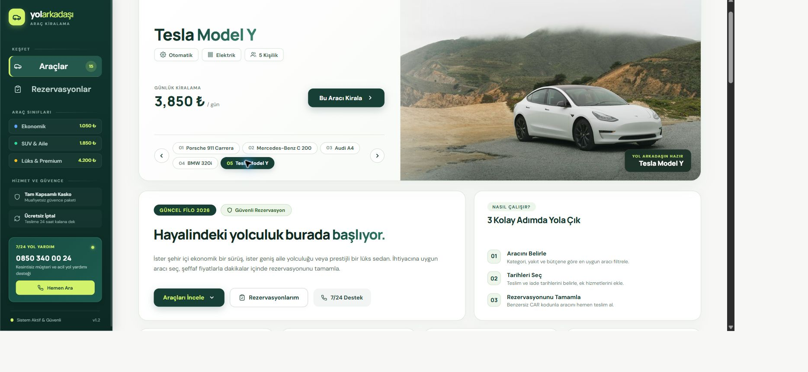

# YolArkadaşı — Araç Kiralama ve Rezervasyon

## 1. Güncel Site Görünümü

Aşağıdaki ekran görüntüsü uygulamanın çalışan ana sayfasından alınmıştır.



## 2. Proje Özeti ve Özellikler

YolArkadaşı, .NET 9 ve Blazor Interactive Server ile geliştirilmiş eğitim amaçlı bir araç kiralama uygulamasıdır. `wwwroot/data/cars.json` dosyasındaki 15 araç ve 4 kategori asenkron yüklenir.

- Öne çıkan araç vitrini ve araç görselleri
- Marka/model araması; kategori, yakıt, vites ve maksimum günlük fiyat filtreleri
- Teslim/iade tarihi seçimi, ek hizmetler ve canlı fiyat özeti
- Müşteri formu doğrulaması, rezervasyon oluşturma ve tarih çakışma uyarısı
- Rezervasyonları görüntüleme, uygun rezervasyonu iptal etme ve durum bildirimi

## 3. Teknoloji ve Mimari

- **Platform:** .NET 9, C#, Razor Components, Blazor Interactive Server
- **Araç verisi:** `CarService` ve `HttpClient`, `wwwroot/data/cars.json`
- **Ana sayfa:** `Components/Pages/Home.razor` — `/` ve `/cars`
- **Araç kataloğu:** `Components/Shared/CarList.razor`
- **Kiralama:** `Components/Pages/Rent.razor` — `/cars/{id}/rent`
- **Kiralama bileşenleri:** `RentalOptions.razor`, `RentalSummary.razor`, `CustomerForm.razor`
- **Rezervasyon listesi:** `Components/Pages/MyBookings.razor` — `/my-bookings`
- **Durum yönetimi:** `RentalState` seçimleri, `BookingState` rezervasyonları yönetir; rezervasyonlar aynı tarayıcı profilinin `localStorage` alanında tutulur.
- **Stiller:** bileşen bazlı `.razor.css` (Scoped CSS) ve ortak `wwwroot/app.css`

Bu bir eğitim prototipidir; gerçek ödeme, merkezi veritabanı ve farklı tarayıcılar arasında ortak rezervasyon desteği içermez.

## 4. Kurulum ve Çalıştırma

Bilgisayarda .NET 9 SDK kurulu olmalıdır. Proje klasöründe terminal açıp çalıştırın:

```powershell
dotnet run
```

Varsayılan HTTP adresi: `http://localhost:5216`.

## 5. Sunum ve Teslim Kontrolü

Sunum videosunda aşağıdaki akışları uygulamada gösterin:

1. `/cars` sayfasında araçları ve arama/filtre seçeneklerini deneyin.
2. Bir araç seçip tarihleri ve ek hizmetleri değiştirin; fiyat özetini gösterin.
3. Form doğrulamasını, başarılı rezervasyonu ve rezervasyon kodunu gösterin.
4. Aynı araçta tarih çakışmasını ve uygun tarih seçimini gösterin.
5. `/my-bookings` sayfasında kaydı, yenileme sonrası kalıcılığı ve iptal bildirimini gösterin.
6. Mobil görünümü ve temel bileşenlerin görevlerini kısaca tanıtın.

Denemediğiniz özellikleri çalışıyor gibi sunmayın. Son teslimde proje kaynaklarını, `proje.txt` dosyasını ve anlatım videosunu ZIP/RAR paketine ekleyin.
