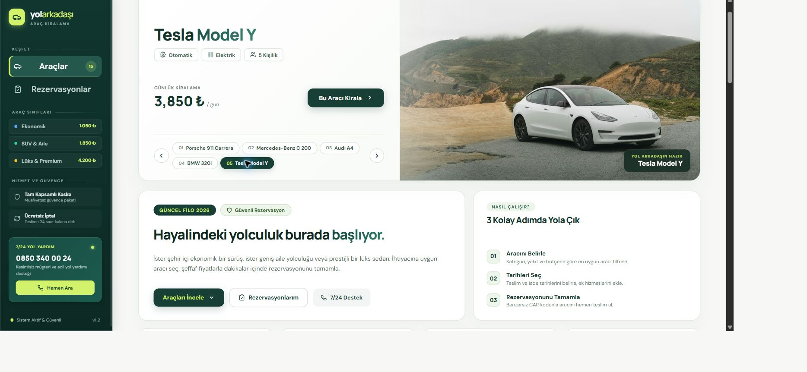
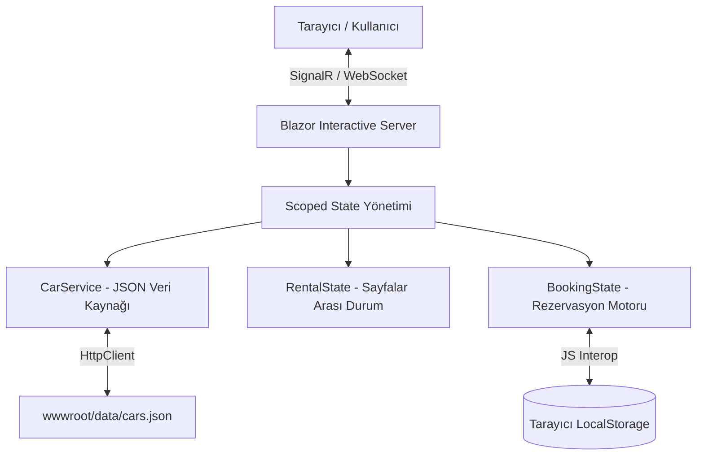

# 🚗 YolArkadaşı — Modern Araç Kiralama & Rezervasyon Platformu

<p align="center">
  
  
  
  
  
</p>

<p align="center">
  <b>YolArkadaşı</b>, modern kurumsal araç kiralama şirketlerinin (Sixt, Hertz, Turo) tasarım ve kullanıcı deneyimi standartları örnek alınarak geliştirilmiş; zengin etkileşimli, bileşen tabanlı ve yüksek performanslı bir <b>Blazor Web Uygulamasıdır</b>.
</p>

---

## 📸 Ekran Görüntüsü

<p align="center">
  
</p>

---

## ✨ Öne Çıkan Özellikler

### 1. 🏎️ Dinamik Araç Vitrini ve Akıllı Filtreleme
- **Öne Çıkan Araç Vitrini (Showcase Slider):** Ana sayfa üstünde yer alan, otomatik geçişli ve prestijli araç vitrini.
- **Canlı Arama & Kategori:** Marka ve modele göre gerçek zamanlı arama; *Ekonomik, SUV & Aile, Lüks & Premium, Orta Sınıf* segment filtreleri.
- **İnteraktif Fiyat Kaydırıcısı (Range Slider):** Statik açılır listeler yerine, bütçeyi canlı ayarlayan özel zümrüt temalı fiyat slider'ı.
- **Özellik Filtreleri:** Yakıt türü (Benzin, Dizel, Hibrit, Elektrik) ve Vites tipi (Otomatik, Manuel) filtreleri.
- **Mikro Etkileşimler:** Fare kartın üzerine geldiğinde 3D süzülme, görsel yakınlaşma (hover zoom) ve müsaitlik durumunu gösteren canlı nabız (`pulse-dot`) efekti.

### 2. 📅 Kusursuz Kiralama & Dinamik Fiyatlandırma Motoru
- **Çok Adımlı İlerleme Takibi (Multi-Step Stepper):** Kiralama akışını görselleştiren aşama çubuğu (*1. Araç Seçimi → 2. Tarih & Hizmet → 3. Onay & Kod*).
- **Gerçek Zamanlı Tutar Hesaplama:** Kiralama gün sayısı ve seçilen ek hizmetlerin (Tam Güvence Kaskosu, Çocuk Koltuğu, Ek Sürücü) anlık toplam tutara yansıması.
- **Tarih Geçerlilik Denetimleri:** Geçmiş tarih seçimi engelleme ve iade tarihinin teslimden sonra olma kuralı.

### 3. 🧠 Çakışma Yönetimi ve Akıllı Müsait Tarih Önerileri
- **Çakışma Tespiti (Conflict Detection):** Seçilen tarihlerde araç başka bir müşteri tarafından rezerve edilmişse, müşteriyi boğmadan sonraki aşamada net gerekçeli bildirim sunar.
- **Müşteri Kaçırmayan Alternatif Öneriler:** Çakışma durumunda algoritma o aracın en yakın 3 boş tarih aralığını hesaplar. Müşteri tek tıkla (`Tarihi Seç ✓`) bu aralığı uygulayabilir ve takvimle uğraşmadan kiralamasını tamamlayabilir.

### 4. 📝 Kurumsal Form Güvenliği ve Doğrulama
- `EditForm`, `DataAnnotationsValidator` ve `ValidationMessage` bileşenleri ile ad-soyad, e-posta ve telefon format kontrolleri.
- Geçersiz girdilerde anında kullanıcı dostu görsel uyarılar.

### 5. 🎉 Kutlama & Belge Yazdırma Deneyimi
- **Kutlama Konfetisi:** Başarılı rezervasyon onayında ekranda patlayan sıfır bağımlılıklı saf HTML5 Canvas konfeti animasyonu.
- **Tekil A4 Fiş Yazdırma (Voucher Print):** Rezervasyonlarım sayfasında basılan her rezervasyon için izole iframe motoruyla resmi formatta tek sayfalık teslimat sözleşmesi/fişi çıktısı.
- **Toplu Liste Dökümü:** İsteğe bağlı olarak tüm filodaki rezervasyonları tek tıkla yazdırma desteği.
- **Rezervasyon İptal Yönetimi:** Henüz kiralama süresi başlamamış olan rezervasyonları tek tıkla iptal etme olanağı.

---

## 🛠️ Mimari ve Teknoloji Yığını



- **Framework:** .NET 9.0 (C# 13)
- **UI Mimarisi:** Blazor Interactive Server & Razor Components
- **Stil Yönetimi:** Scoped CSS (`.razor.css`) + Global Tema (`app.css`)
- **İstemci Kalıcılığı:** JavaScript Interop ile LocalStorage kalıcılığı
- **İkonlar:** Modern, hafif ve ölçeklenebilir SVG vektör ikon kütüphanesi

---

## 📂 Proje Dizin Yapısı

```text
├── Components/
│   ├── Layout/
│   │   ├── MainLayout.razor        # Ana sayfa iskeleti
│   │   └── NavMenu.razor           # Zümrüt temalı sol navigasyon barı
│   ├── Pages/
│   │   ├── Home.razor              # Araç vitrini & ana sayfa (/ ve /cars)
│   │   ├── Rent.razor              # Kiralama, opsiyonlar ve müşteri formu (/cars/{id}/rent)
│   │   └── MyBookings.razor        # Rezervasyonlarım ve fiş yazdırma (/my-bookings)
│   └── Shared/
│       ├── CarList.razor           # Araç kartları & filtreleme paneli
│       ├── RentalOptions.razor     # Tarih seçici ve ek hizmet tercihleri
│       ├── RentalSummary.razor     # Anlık sepet ve toplam ücret özeti
│       └── CustomerForm.razor      # Müşteri iletişim formu ve doğrulama
├── Models/
│   ├── Car.cs                      # Araç veri modeli
│   ├── CarBooking.cs               # Rezervasyon veri modeli
│   └── CustomerInput.cs            # Form doğrulama modeli
├── Services/
│   ├── CarService.cs               # cars.json asenkron veri servisi
│   ├── RentalState.cs              # Kiralama seçimleri scoped state
│   └── BookingState.cs             # Rezervasyon & çakışma kontrol motoru
├── wwwroot/
│   ├── data/cars.json              # 15 araçlık genişletilmiş filo verisi
│   ├── images/cars/                # Yüksek çözünürlüklü 3:2 araç fotoğrafları
│   └── js/localStorage.js         # LocalStorage, konfeti ve fiş yazdırma motoru
└── Program.cs                      # Uygulama bağımlılık enjeksiyonu ve middleware
```

---

## ⚡ Hızlı Başlangıç

Projeyi yerel ortamınızda çalıştırmak için:

### Gereksinimler
- [.NET 9.0 SDK](https://dotnet.microsoft.com/download/dotnet/9.0)

### Kurulum

1. Depoyu klonlayın:
   ```bash
   git clone https://github.com/Azo15/YolArkadasi-Arac-Kiralama.git
   cd YolArkadasi-Arac-Kiralama
   ```

2. Gerekli bağımlılıkları yükleyin:
   ```bash
   dotnet restore
   ```

3. Uygulamayı derleyin ve başlatın:
   ```bash
   dotnet run --launch-profile http
   ```

4. Tarayıcınızda açın:
   ```
   http://localhost:5216
   ```

---

## 👨‍💻 Geliştirici

- **Geliştirici:** Azo İSMAİL
- **GitHub:** [@Azo15](https://github.com/Azo15)
- **E-Posta:** ismailazo260@gmail.com

---

